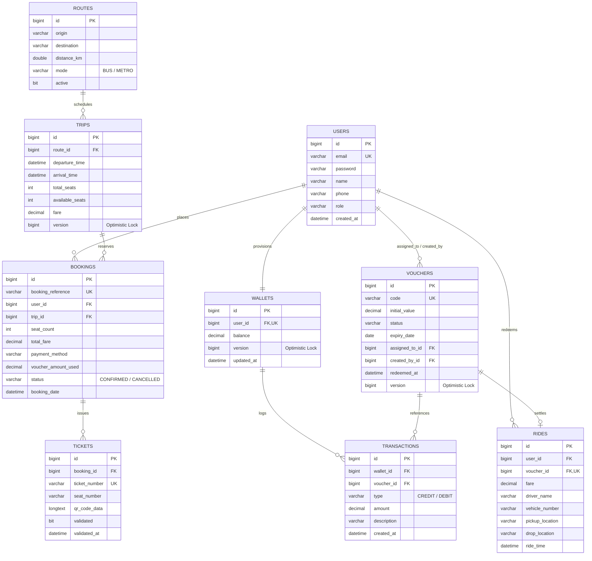

# Mobility Wallet 🚊💳

[](https://www.oracle.com/java/)
[](https://spring.io/projects/spring-boot)
[](https://www.mysql.com/)
[](https://www.thymeleaf.org/)
[](http://localhost:8080/swagger-ui.html)
[](#automated-testing-suite)

> **Enterprise-Grade Closed-Loop Prepaid Transit Allowance & Multi-Modal Ticketing Platform**  
> Engineered with optimistic locking concurrency defenses (`@Version`), atomic QR redemptions (ZXing), an immutable append-only ledger, and dual security filter chains (Stateless REST + Session-based Web UI).

---

## 📑 Table of Contents
1. [Executive Summary & Problem Statement](#1-executive-summary--problem-statement)
2. [Key Capabilities & Innovations](#2-key-capabilities--innovations)
3. [System Architecture & Design Patterns](#3-system-architecture--design-patterns)
4. [Relational Data Model & ER Diagram](#4-relational-data-model--er-diagram)
5. [Local Setup & MySQL Configuration](#5-local-setup--mysql-configuration)
6. [Pre-Seeded Demo Credentials](#6-pre-seeded-demo-credentials)
7. [Automated Testing Suite (102 Tests)](#7-automated-testing-suite-102-tests)
8. [REST API Documentation & cURL Commands](#8-rest-api-documentation--curl-commands)
9. [Web User Interface Walkthrough](#9-web-user-interface-walkthrough)
10. [Technical Interview Preparation Guide](#10-technical-interview-preparation-guide)

---

## 1. Executive Summary & Problem Statement

Organizations (corporations, university campuses, and event organizers) routinely disburse mobility subsidies to employees and students. Traditional expense workflows suffer from:
- **Cash advances** with zero spending bounds or real-time traceability.
- **Reimbursement friction:** Manual paper receipts, weeks of spreadsheet validation, and high administrative overhead.
- **Financial leakage:** Mobility funds disbursed as untracked cash are frequently diverted to non-transit expenses.

**Mobility Wallet** solves this through a closed-loop digital prepaid voucher and transit ticketing architecture:
- **Purpose-Bound Spending:** Organization-issued vouchers can strictly be used for verified taxi rides or scheduled transit seat reservations.
- **Zero Financial Leakage:** Unused vouchers expire automatically and return unused allowances to the enterprise pool.
- **Zero Double-Redemption & Zero Overbooking:** Mathematical concurrency controls (`@Version` optimistic locking with exponential backoff) prevent concurrent double-spends and overbooked seats.
- **Immutable Financial Ledger:** Every credit, debit, redemption, and cancellation refund is appended to an immutable audit ledger.

---

## 2. Key Capabilities & Innovations

- **Prepaid Allowance Wallets:** Auto-provisioned for commuters upon registration with `0.00` balance. Uses arbitrary-precision `BigDecimal` (MySQL `DECIMAL(12,2)`) to eliminate floating-point rounding errors.
- **Voucher Engine:** Single and bulk batch generation (`VCH-YYYY-XXXXXX`), lifecycle transitions (`CREATED` $\rightarrow$ `ASSIGNED` $\rightarrow$ `REDEEMED` / `EXPIRED`), lazy expiration checks, and automated midnight sweeps.
- **ZXing Dynamic QR Verification:** Dynamic generation of scannable Base64 data URIs and raw PNG QR codes for both taxi vouchers and transit boarding passes.
- **Taxi Ride Settlement:** Atomic redemption recording driver credentials, vehicle registration, pickup/drop locations, and meter fare.
- **High-Concurrency Transit Engine:** Scheduled trips across Bus and Metro routes, sequential seat numbering, and split payments (voucher face value + wallet balance).
- **100% Cancellation Refund:** Commuters can cancel upcoming trips before departure, automatically replenishing trip seat capacity and refunding 100% of the fare back to their digital wallet.
- **Executive Analytics:** Real-time Chart.js dashboards showing 7-day daily spend velocity, voucher conversion funnels, route gross revenues, and seat load factors.

---

## 3. System Architecture & Design Patterns

The platform is designed as a modular monolithic Spring Boot 3 enterprise application cleanly separating Web MVC, REST APIs, Service Orchestration, and Data Persistence.

```
                                  +-------------------------------------------------------+
                                  |                     Browser Client                    |
                                  |         (HTML5 + Vanilla CSS + Chart.js + ZXing)      |
                                  +---------------------------+---------------------------+
                                                              |
                                           HTTPS / Session Cookie / HTTP Basic
                                                              |
                                                              v
+-------------------------------------------------------------------------------------------------------------------------+
|                                              Spring Boot 3 Application Layer                                            |
|                                                                                                                         |
|   +---------------------------------------+                          +----------------------------------------------+   |
|   |   Web MVC Controllers (Thymeleaf)     |                          |         REST Controllers (/api/**)           |   |
|   |  - AuthWebController                  |                          |  - AuthApiController                         |   |
|   |  - UserDashboardWebController         |                          |  - VoucherApiController                      |   |
|   |  - AdminWebController                 |                          |  - TransitApiController                      |   |
|   |                                       |                          |  - RideApiController                         |   |
|   |                                       |                          |  - WalletApiController                       |   |
|   |                                       |                          |  - AdminApiController                        |   |
|   |                                       |                          |  - UserApiController                         |   |
|   +-------------------+-------------------+                          +----------------------+-----------------------+   |
|                       |                                                                     |                           |
|                       +----------------------------------+----------------------------------+                           |
|                                                          |                                                              |
|                                                          v                                                              |
|                                         +----------------------------------+                                            |
|                                         |        Security Layer            |                                            |
|                                         | - Filter 1: /api/** (Stateless)  |                                            |
|                                         | - Filter 2: Web UI (Session)     |                                            |
|                                         | - BCrypt Hashing, Role Separation|                                            |
|                                         +----------------+-----------------+                                            |
|                                                          |                                                              |
|                                                          v                                                              |
|                                         +----------------------------------+                                            |
|                                         |         Service Layer            |                                            |
|                                         | - WalletService                  |                                            |
|                                         | - VoucherService                 |                                            |
|                                         | - RideService                    |                                            |
|                                         | - TransitService                 |                                            |
|                                         | - QrCodeService (ZXing)          |                                            |
|                                         | - AnalyticsService               |                                            |
|                                         +----------------+-----------------+                                            |
|                                                          |                                                              |
|                                                          v                                                              |
|                                         +----------------------------------+                                            |
|                                         |       Repository Layer           |                                            |
|                                         | - Spring Data JPA Repositories   |                                            |
|                                         | - Optimistic Locking (@Version)  |                                            |
|                                         | - Fetch-Joined Open-In-View Off  |                                            |
|                                         +----------------+-----------------+                                            |
|                                                          |                                                              |
+----------------------------------------------------------|--------------------------------------------------------------+
                                                           v
                                         +----------------------------------+
                                         |         Database Layer           |
                                         |  MySQL 8.0 (InnoDB, ACID, UTF8)  |
                                         +----------------------------------+
```

### Security Architecture (Dual `SecurityFilterChain`)
1. **Chain 1 (`@Order(1)` for `/api/**`):** Stateless REST API session management (`SessionCreationPolicy.STATELESS`), CSRF disabled, HTTP Basic authentication, custom `RestAuthenticationEntryPoint` returning 401 JSON, and `RestAccessDeniedHandler` returning 403 JSON.
2. **Chain 2 (`@Order(2)` for Web UI):** Session-based form login at `/login`, logout at `/logout`, CSRF tokens enabled, and `RoleBasedAuthenticationSuccessHandler` dynamically redirecting `ROLE_ADMIN` to `/admin/dashboard` and `ROLE_USER` to `/user/dashboard`.

---

## 4. Relational Data Model & ER Diagram



---

## 5. Local Setup & MySQL Configuration

### Prerequisites
- **JDK 17** or higher (`java -version`)
- **Apache Maven 3.9+** (`mvn -version`)
- **MySQL Server 8.0+** running on `localhost:3306`

### Database Configuration
1. Open **MySQL Workbench** or your terminal client and ensure MySQL is running:
   ```sql
   CREATE DATABASE IF NOT EXISTS mobility_wallet;
   ```
2. Verify credentials in [`src/main/resources/application-dev.properties`](file:///c:/Users/Anannya%20Salvi/OneDrive/Desktop/PBL%20project/src/main/resources/application-dev.properties):
   ```properties
   spring.datasource.url=jdbc:mysql://localhost:3306/mobility_wallet?createDatabaseIfNotExist=true&useSSL=false&allowPublicKeyRetrieval=true&serverTimezone=UTC
   spring.datasource.username=root
   spring.datasource.password=Password
   spring.jpa.hibernate.ddl-auto=update
   ```
   *(You can also override via environment variables: `DB_URL`, `DB_USERNAME`, `DB_PASSWORD`, `PORT`)*.

### Running the Application
```powershell
mvn spring-boot:run
```

Once started:
- **Web Portal:** [http://localhost:8080/](http://localhost:8080/)
- **Swagger UI:** [http://localhost:8080/swagger-ui.html](http://localhost:8080/swagger-ui.html)
- **OpenAPI JSON Spec:** [http://localhost:8080/v3/api-docs](http://localhost:8080/v3/api-docs)
- **Health Check:** [http://localhost:8080/api/health](http://localhost:8080/api/health)

---

## 6. Pre-Seeded Demo Credentials

The platform initializes demo records automatically on startup via `DataInitializer`:

| Role | Email Address | Password | Initial State |
| :--- | :--- | :--- | :--- |
| **System Administrator** | `admin@mobility.com` | `admin123` | Full access to `/admin/**` dashboard, analytics, voucher issuance, and route manager. |
| **Commuter User** | `user@mobility.com` | `user123` | Active wallet with ₹750.00 allowance, assigned vouchers (`VOUCH-COMMUTE-100`, `VOUCH-TAXI-50`). |

*(The Sign In page at `/login` provides 1-click **Quick Fill** buttons for both accounts for rapid testing).*

---

## 7. Automated Testing Suite (102 Tests)

The test suite runs hermetically using H2 in-memory mode under `@ActiveProfiles("test")` with zero dependency on local MySQL state.

Execute the test suite:
```powershell
mvn test
```

### Test Suite Highlights
- **`VoucherDoubleRedeemConcurrencyTest`:** Spawns 10 parallel threads via `ExecutorService` and `CountDownLatch(1)` firing simultaneously against the exact same voucher. Confirms mathematically that **exactly 1** succeeds and **exactly 9** fail with `VoucherAlreadyRedeemedException`, leaving the database in a valid state.
- **`SeatOverbookingConcurrencyTest`:** Configures a trip with 1 remaining seat and fires 10 simultaneous booking threads. Confirms mathematically that **exactly 1** booking succeeds, **exactly 9** fail with `SeatOverbookedException`, and available seats never drop below zero.
- **`WebPortalIntegrationTest`:** End-to-end integration tests of all Thymeleaf views, models, CSRF protections, and form actions (booking, cancellation, voucher issuance, and taxi redemption).
- **`EntityAndRepositoryTests`:** Tests cascading, auditing timestamps (`@CreationTimestamp`), optimistic locking version increments, and ledger aggregation queries.

---

## 8. REST API Documentation & cURL Commands

All REST endpoints reside under `/api/**` and use **HTTP Basic Authentication**.

### 1. Health Check (Public)
```bash
curl -X GET http://localhost:8080/api/health
```

### 2. Commuter Registration (Public)
```bash
curl -X POST http://localhost:8080/api/auth/register \
  -H "Content-Type: application/json" \
  -d '{
    "name": "Jane Commuter",
    "email": "jane@company.com",
    "password": "Password123",
    "phone": "9876543210"
  }'
```

### 3. Check Wallet Balance & Ledger (Commuter)
```bash
curl -X GET http://localhost:8080/api/wallet/my \
  -u user@mobility.com:user123
```

```bash
curl -X GET http://localhost:8080/api/wallet/transactions?page=0&size=10 \
  -u user@mobility.com:user123
```

### 4. Search Transit Schedules (Public / Commuter)
```bash
curl -X GET "http://localhost:8080/api/transit/trips/search?origin=Campus&destination=Tech%20Park&date=2026-10-05"
```

### 5. Book Seats with Concurrency Protection (Commuter)
```bash
curl -X POST http://localhost:8080/api/transit/book \
  -u user@mobility.com:user123 \
  -H "Content-Type: application/json" \
  -d '{
    "tripId": 1,
    "seatCount": 1,
    "paymentMethod": "WALLET"
  }'
```

### 6. Cancel Booking & Receive 100% Refund (Commuter)
```bash
curl -X POST http://localhost:8080/api/transit/bookings/1/cancel \
  -u user@mobility.com:user123
```

### 7. Redeem Voucher for Taxi Ride (Driver / Commuter)
```bash
curl -X POST http://localhost:8080/api/rides/redeem \
  -H "Content-Type: application/json" \
  -d '{
    "voucherCode": "VOUCH-TAXI-50",
    "driverName": "Suresh Patil",
    "vehicleNumber": "MH-02-AB-5678",
    "pickupLocation": "Campus East Gate",
    "dropLocation": "Tech Park Tower A",
    "fare": 50.00
  }'
```

### 8. Issue Bulk Vouchers (Admin)
```bash
curl -X POST http://localhost:8080/api/vouchers/bulk \
  -u admin@mobility.com:admin123 \
  -H "Content-Type: application/json" \
  -d '{
    "count": 5,
    "initialValue": 100.00,
    "expiryDate": "2026-12-31"
  }'
```

### 9. Executive Analytics (Admin)
```bash
curl -X GET http://localhost:8080/api/admin/analytics \
  -u admin@mobility.com:admin123
```

---

## 9. Web User Interface Walkthrough

1. **Sign In (`/login`):**
   - Click the **"👤 Commuter"** or **"🛡️ Admin"** quick-fill button to populate credentials without typing.
2. **Commuter Workspace (`/user/dashboard`):**
   - **Overview:** Active wallet balance, quick actions, and recent activity.
   - **My Vouchers & QR:** Displays assigned vouchers. Click **"Show QR Code"** to render a high-resolution ZXing QR code modal.
   - **Simulate Taxi Ride Settlement:** Enter driver name and vehicle details to simulate instant voucher redemption.
   - **Search & Book Transit:** Search by route and date, view available capacity bars, and confirm seat reservations.
   - **My Bookings & Tickets:** View boarding tickets with verification QR codes or cancel for a 100% wallet refund.
   - **Transaction Ledger:** Append-only table of all deposits, debits, and refunds.
3. **Administrator Workspace (`/admin/dashboard`):**
   - **Visual Analytics:** Interactive Chart.js charts showing daily spend, voucher conversion funnels, and seat occupancy.
   - **Voucher Operations:** Issue single vouchers or generate batches of 50+ unique codes. Assign pool vouchers to registered commuters.
   - **Route & Trip Scheduling:** Define routes and schedule future bus and metro departures.
   - **Taxi Ride Audits:** Complete audit log of driver redemptions and meter fares.

---

## 10. Technical Interview Preparation Guide

When discussing this project in a software engineering technical interview, use these key talking points:

### 1. Why Optimistic Locking (`@Version`) over Pessimistic Locking (`SELECT FOR UPDATE`)?
- **Pessimistic locking** acquires database locks on rows at read time, serializing database access. In high-traffic transit search and ticketing engines, thousands of commuters search schedules simultaneously; holding row locks degrades throughput and causes connection pool starvation.
- **Optimistic locking** assumes collisions are the exception rather than the norm. Reads are completely non-blocking (`SELECT` without locks). When writing updates, Hibernate verifies the version predicate:
  ```sql
  UPDATE trips SET available_seats = ?, version = version + 1 WHERE id = ? AND version = ?
  ```
  If another transaction updated the row first, Hibernate detects that 0 rows were updated and throws `OptimisticLockException`. Our `TransitService` catches this collision and retries up to 3 times with exponential backoff and randomized jitter before rejecting the request.

### 2. Why `BigDecimal` instead of `float` or `double` for currency?
- Binary floating-point primitives (`float` and `double`) adhere to IEEE 754 standards, which represent numbers as binary fractions. Fractions like `0.10` or `0.70` cannot be represented precisely in binary, causing rounding leakage (e.g., `0.7000000000000001`).
- `BigDecimal` represents arbitrary-precision signed decimal numbers, ensuring exact currency calculations. We map all money fields to MySQL `DECIMAL(12, 2)` to guarantee audit consistency down to the exact cent/paisa.

### 3. How is the Ledger Immutable?
- The `Transaction` table is strictly append-only. There are no `@Modifying UPDATE` or `DELETE` repository methods on transactions.
- When a booking is placed, a new `DEBIT` transaction is inserted. When a booking is cancelled, the original debit is never removed or altered; instead, an offsetting `CREDIT` transaction is recorded referencing the cancelled booking. This maintains an immutable paper trail required for SOX and financial audit compliance.

### 4. Why is Open-In-View Disabled (`spring.jpa.open-in-view=false`)?
- Spring Boot enables Open-In-View (OSIV) by default, keeping the Hibernate `EntityManager` open throughout the entire HTTP request lifecycle. While convenient, it leads to the notorious **$N+1$ select problem** (lazy loading queries executing during view rendering inside templates).
- By setting `spring.jpa.open-in-view=false`, the persistence context closes as soon as the `@Transactional` service method returns. To avoid `LazyInitializationException`, our repositories use explicit `JOIN FETCH` queries (e.g., `findAllWithUsers`, `findByWalletUserIdWithDetailsOrderByCreatedAtDesc`), ensuring all required relationships are fetched in a single efficient SQL query.

### 5. Why Dual `SecurityFilterChain` Beans?
- Browser-based users require stateful sessions, cookie handling, form login redirects, and CSRF protection.
- REST API consumers (mobile apps, conductor handheld scanners, external partners) require stateless authentication (`SessionCreationPolicy.STATELESS`), HTTP Basic or Token authentication, JSON 401/403 responses, and disabled CSRF.
- Defining two distinct `@Bean SecurityFilterChain` instances with `@Order(1)` matching `/api/**` and `@Order(2)` matching `/**` cleanly separates these concerns without compromising security.
