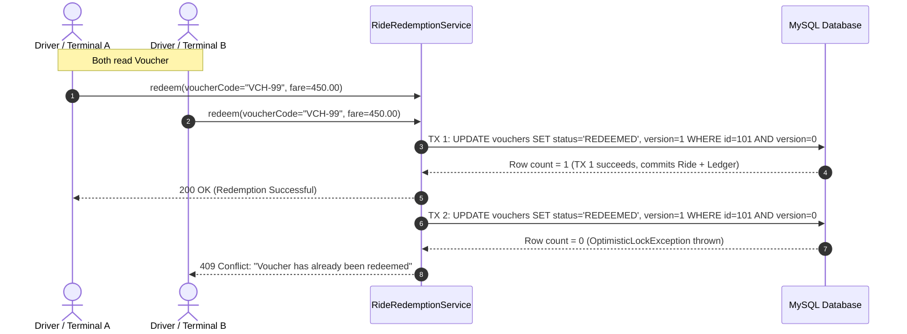

# Mobility Wallet — Technical Requirements Document (TRD)

**Version:** 1.0  
**Companion Document:** `PRD.md`  
**Target Environment:** Java 17 | Spring Boot 3.2+ | MySQL 8.0 | Maven 3.9+  

---

## 1. System Architecture Overview

The system is designed as a modular, monolithic Spring Boot 3 enterprise application exposing both a server-rendered Thymeleaf Web UI and a REST API under `/api`.

```text
                                  +-------------------------------------------------------+
                                  |                     Browser Client                    |
                                  |  (Desktop / Mobile Web: HTML5 + CSS + Minimal JS)     |
                                  +---------------------------+---------------------------+
                                                              |
                                           HTTPS / Session Cookie / HTTP Basic
                                                              |
                                                              v
+-------------------------------------------------------------------------------------------------------------------------+
|                                              Spring Boot 3 Application Layer                                            |
|                                                                                                                         |
|   +---------------------------------------+                          +----------------------------------------------+   |
|   |   Web MVC Controllers (Thymeleaf)     |                          |         REST Controllers (/api/**)           |   |
|   |  - AuthWebController                  |                          |  - AuthApiController                         |   |
|   |  - UserDashboardWebController         |                          |  - VoucherApiController                      |   |
|   |  - BookingWebController               |                          |  - TransitApiController                      |   |
|   |  - AdminWebController                 |                          |  - AnalyticsApiController                    |   |
|   +-------------------+-------------------+                          +----------------------+-----------------------+   |
|                       |                                                                     |                           |
|                       +----------------------------------+----------------------------------+                           |
|                                                          |                                                              |
|                                                          v                                                              |
|                                         +----------------------------------+                                            |
|                                         |        Security Layer            |                                            |
|                                         | - Spring Security 6 (BCrypt)     |                                            |
|                                         | - Role-Based (ROLE_USER, ADMIN)  |                                            |
|                                         | - Session & Basic Auth Filters   |                                            |
|                                         +----------------+-----------------+                                            |
|                                                          |                                                              |
|                                                          v                                                              |
|                                         +----------------------------------+                                            |
|                                         |         Service Layer            |                                            |
|                                         | - WalletService                  |                                            |
|                                         | - VoucherService                 |                                            |
|                                         | - RideRedemptionService          |                                            |
|                                         | - TransitBookingService          |                                            |
|                                         | - ConcurrencyRetryService        |                                            |
|                                         | - QrCodeGeneratorService (ZXing) |                                            |
|                                         | - AnalyticsService               |                                            |
|                                         +----------------+-----------------+                                            |
|                                                          |                                                              |
|                                                          v                                                              |
|                                         +----------------------------------+                                            |
|                                         |       Repository Layer           |                                            |
|                                         | - Spring Data JPA Repositories   |                                            |
|                                         | - Optimistic Locking (@Version)  |                                            |
|                                         +----------------+-----------------+                                            |
+----------------------------------------------------------|--------------------------------------------------------------+
                                                           |
                                                           v
                                         +----------------------------------+
                                         |         Database Layer           |
                                         |  MySQL 8.0 (InnoDB, ACID, UTF8)  |
                                         +----------------------------------+
```

---

## 2. Technology Stack & Dependencies

| Component | Technology | Version | Architectural Rationale |
|---|---|---|---|
| **Language** | Java | 17 (LTS) | Modern Java features (records, text blocks, pattern matching, sealed classes). |
| **Framework** | Spring Boot | 3.2.x | Latest enterprise standard, Jakarta EE 10 namespace, built-in observability. |
| **Build Tool** | Apache Maven | 3.9+ | Standard dependency and lifecycle management. |
| **Database** | MySQL | 8.0.x | Relational ACID compliance, InnoDB row-level locking, foreign key constraints. |
| **ORM / Data** | Spring Data JPA / Hibernate | 6.x | Domain-driven entities, repository abstraction, `@Version` optimistic locking. |
| **Security** | Spring Security | 6.x | BCrypt password hashing, session management, method-level security (`@PreAuthorize`). |
| **Templating** | Thymeleaf + Extras | 3.1+ | Clean server-side HTML rendering without JavaScript framework bloat. |
| **QR Code Engine** | ZXing (Zebra Crossing) | 3.5.3 | Pure Java QR code generation as Base64 data URIs and byte arrays. |
| **API Docs** | SpringDoc OpenAPI | 2.3+ | Auto-generated Swagger UI (`/swagger-ui.html`) and OpenAPI v3 specs. |
| **Validation** | Jakarta Bean Validation | 3.0+ | Declarative input validation (`@NotNull`, `@Positive`, `@Future`, `@NotBlank`). |
| **Testing** | JUnit 5, Mockito, AssertJ | Latest | High-fidelity unit, slice (`@DataJpaTest`), and multi-threaded integration tests. |

---

## 3. Package & Directory Structure

```text
mobility-wallet/
├── pom.xml
├── README.md
├── PRD.md
├── TRD.md
├── STARTER_PROMPT.md
├── PROJECT_CONTEXT.md
└── src/
    ├── main/
    │   ├── java/com/mobilitywallet/
    │   │   ├── MobilityWalletApplication.java
    │   │   ├── config/
    │   │   │   ├── SecurityConfig.java
    │   │   │   ├── OpenApiConfig.java
    │   │   │   ├── WebMvcConfig.java
    │   │   │   └── DataInitializer.java
    │   │   ├── controller/
    │   │   │   ├── api/
    │   │   │   │   ├── AuthApiController.java
    │   │   │   │   ├── VoucherApiController.java
    │   │   │   │   ├── TransitApiController.java
    │   │   │   │   └── AnalyticsApiController.java
    │   │   │   └── web/
    │   │   │       ├── AuthWebController.java
    │   │   │       ├── UserDashboardWebController.java
    │   │   │       ├── TransitWebController.java
    │   │   │       └── AdminWebController.java
    │   │   ├── dto/
    │   │   │   ├── request/
    │   │   │   │   ├── UserRegisterRequest.java
    │   │   │   │   ├── VoucherCreateRequest.java
    │   │   │   │   ├── VoucherBulkCreateRequest.java
    │   │   │   │   ├── TaxiRedeemRequest.java
    │   │   │   │   └── BookingRequest.java
    │   │   │   └── response/
    │   │   │       ├── ApiResponse.java
    │   │   │       ├── VoucherResponse.java
    │   │   │       ├── TripSearchResponse.java
    │   │   │       ├── BookingSummaryResponse.java
    │   │   │       └── AnalyticsSummaryResponse.java
    │   │   ├── entity/
    │   │   │   ├── User.java
    │   │   │   ├── Role.java (Enum: ROLE_USER, ROLE_ADMIN)
    │   │   │   ├── Wallet.java
    │   │   │   ├── Voucher.java
    │   │   │   ├── VoucherStatus.java (Enum: CREATED, ASSIGNED, REDEEMED, EXPIRED)
    │   │   │   ├── Transaction.java
    │   │   │   ├── TransactionType.java (Enum: CREDIT, DEBIT)
    │   │   │   ├── Route.java
    │   │   │   ├── Trip.java
    │   │   │   ├── Booking.java
    │   │   │   ├── BookingStatus.java (Enum: CONFIRMED, CANCELLED)
    │   │   │   ├── Ticket.java
    │   │   │   └── Ride.java
    │   │   ├── exception/
    │   │   │   ├── BusinessException.java
    │   │   │   ├── ResourceNotFoundException.java
    │   │   │   ├── InsufficientBalanceException.java
    │   │   │   ├── VoucherAlreadyRedeemedException.java
    │   │   │   ├── SeatOverbookedException.java
    │   │   │   ├── InvalidVoucherStateException.java
    │   │   │   ├── GlobalExceptionHandler.java
    │   │   │   └── ErrorDetails.java
    │   │   ├── repository/
    │   │   │   ├── UserRepository.java
    │   │   │   ├── WalletRepository.java
    │   │   │   ├── VoucherRepository.java
    │   │   │   ├── TransactionRepository.java
    │   │   │   ├── RouteRepository.java
    │   │   │   ├── TripRepository.java
    │   │   │   ├── BookingRepository.java
    │   │   │   ├── TicketRepository.java
    │   │   │   └── RideRepository.java
    │   │   └── service/
    │   │       ├── UserService.java
    │   │       ├── WalletService.java
    │   │       ├── VoucherService.java
    │   │       ├── RideService.java
    │   │       ├── TransitService.java
    │   │       ├── QrCodeService.java
    │   │       ├── AnalyticsService.java
    │   │       └── impl/
    │   └── resources/
    │       ├── application.properties
    │       ├── static/
    │       │   ├── css/
    │       │   │   ├── main.css
    │       │   │   ├── dashboard.css
    │       │   │   └── admin.css
    │       │   └── js/
    │       │       └── analytics-chart.js
    │       └── templates/
    │           ├── fragments/
    │           │   ├── layout.html
    │           │   ├── navbar.html
    │           │   └── footer.html
    │           ├── auth/
    │           │   ├── login.html
    │           │   └── register.html
    │           ├── user/
    │           │   ├── dashboard.html
    │           │   ├── vouchers.html
    │           │   ├── book-trip.html
    │           │   ├── my-tickets.html
    │           │   └── transactions.html
    │           └── admin/
    │               ├── dashboard.html
    │               ├── vouchers-manage.html
    │               ├── trips-manage.html
    │               └── rides-audit.html
    └── test/
        └── java/com/mobilitywallet/
            ├── service/
            │   ├── VoucherServiceTest.java
            │   ├── TransitBookingServiceTest.java
            │   └── WalletServiceTest.java
            └── concurrency/
                ├── VoucherDoubleRedeemConcurrencyTest.java
                └── SeatOverbookingConcurrencyTest.java
```

---

## 4. Entity Schema & Relational Specifications

All money attributes are mapped to `java.math.BigDecimal` and MySQL `DECIMAL(12,2)`.

### 4.1 Entities

#### 1. `User`
* `id`: `BIGINT AUTO_INCREMENT PRIMARY KEY`
* `name`: `VARCHAR(100) NOT NULL`
* `email`: `VARCHAR(120) NOT NULL UNIQUE`
* `password`: `VARCHAR(255) NOT NULL` (BCrypt encoded)
* `phone`: `VARCHAR(20)`
* `role`: `ENUM('ROLE_USER', 'ROLE_ADMIN') NOT NULL`
* `createdAt`: `DATETIME NOT NULL`

#### 2. `Wallet`
* `id`: `BIGINT AUTO_INCREMENT PRIMARY KEY`
* `user_id`: `BIGINT NOT NULL UNIQUE FK -> users(id)`
* `balance`: `DECIMAL(12,2) NOT NULL DEFAULT 0.00`
* `version`: `BIGINT NOT NULL DEFAULT 0` (`@Version` for balance concurrency)
* `updatedAt`: `DATETIME NOT NULL`

#### 3. `Voucher`
* `id`: `BIGINT AUTO_INCREMENT PRIMARY KEY`
* `code`: `VARCHAR(64) NOT NULL UNIQUE` (Indexed)
* `initialValue`: `DECIMAL(12,2) NOT NULL`
* `status`: `ENUM('CREATED', 'ASSIGNED', 'REDEEMED', 'EXPIRED') NOT NULL` (Indexed)
* `expiryDate`: `DATE NOT NULL` (Indexed)
* `assigned_to_id`: `BIGINT FK -> users(id) NULL`
* `created_by_id`: `BIGINT FK -> users(id) NOT NULL`
* `redeemedAt`: `DATETIME NULL`
* `version`: `BIGINT NOT NULL DEFAULT 0` (`@Version` for double-redemption prevention)

#### 4. `Transaction`
* `id`: `BIGINT AUTO_INCREMENT PRIMARY KEY`
* `wallet_id`: `BIGINT NOT NULL FK -> wallets(id)`
* `voucher_id`: `BIGINT NULL FK -> vouchers(id)`
* `type`: `ENUM('CREDIT', 'DEBIT') NOT NULL`
* `amount`: `DECIMAL(12,2) NOT NULL`
* `description`: `VARCHAR(255) NOT NULL`
* `createdAt`: `DATETIME NOT NULL` (Indexed)

#### 5. `Route`
* `id`: `BIGINT AUTO_INCREMENT PRIMARY KEY`
* `origin`: `VARCHAR(100) NOT NULL`
* `destination`: `VARCHAR(100) NOT NULL`
* `distanceKm`: `DOUBLE NOT NULL`
* `mode`: `ENUM('BUS', 'METRO') NOT NULL`
* `active`: `BOOLEAN NOT NULL DEFAULT TRUE`

#### 6. `Trip`
* `id`: `BIGINT AUTO_INCREMENT PRIMARY KEY`
* `route_id`: `BIGINT NOT NULL FK -> routes(id)`
* `departureTime`: `DATETIME NOT NULL` (Indexed)
* `arrivalTime`: `DATETIME NOT NULL`
* `totalSeats`: `INT NOT NULL`
* `availableSeats`: `INT NOT NULL`
* `fare`: `DECIMAL(12,2) NOT NULL`
* `version`: `BIGINT NOT NULL DEFAULT 0` (`@Version` for seat overbooking prevention)

#### 7. `Booking`
* `id`: `BIGINT AUTO_INCREMENT PRIMARY KEY`
* `bookingReference`: `VARCHAR(32) NOT NULL UNIQUE`
* `user_id`: `BIGINT NOT NULL FK -> users(id)`
* `trip_id`: `BIGINT NOT NULL FK -> trips(id)`
* `seatCount`: `INT NOT NULL`
* `totalFare`: `DECIMAL(12,2) NOT NULL`
* `paymentMethod`: `ENUM('WALLET', 'VOUCHER', 'SPLIT') NOT NULL`
* `status`: `ENUM('CONFIRMED', 'CANCELLED') NOT NULL`
* `bookingDate`: `DATETIME NOT NULL`
* `version`: `BIGINT NOT NULL DEFAULT 0`

#### 8. `Ticket`
* `id`: `BIGINT AUTO_INCREMENT PRIMARY KEY`
* `booking_id`: `BIGINT NOT NULL FK -> bookings(id)`
* `seatNumber`: `VARCHAR(16) NOT NULL`
* `ticketNumber`: `VARCHAR(32) NOT NULL UNIQUE`
* `qrCodeData`: `TEXT NOT NULL` (Base64 data URI generated by ZXing)
* `validated`: `BOOLEAN NOT NULL DEFAULT FALSE`
* `validatedAt`: `DATETIME NULL`

#### 9. `Ride`
* `id`: `BIGINT AUTO_INCREMENT PRIMARY KEY`
* `user_id`: `BIGINT NOT NULL FK -> users(id)`
* `voucher_id`: `BIGINT NOT NULL UNIQUE FK -> vouchers(id)`
* `driverName`: `VARCHAR(100) NOT NULL`
* `vehicleNumber`: `VARCHAR(32) NOT NULL`
* `pickupLocation`: `VARCHAR(150) NOT NULL`
* `dropLocation`: `VARCHAR(150) NOT NULL`
* `fare`: `DECIMAL(12,2) NOT NULL`
* `rideTime`: `DATETIME NOT NULL`

---

## 5. Concurrency & Integrity Protocol

### 5.1 Preventing Double Voucher Redemption


### 5.2 Preventing Seat Overbooking (Optimistic Lock + Retry)
```java
@Transactional(isolation = Isolation.READ_COMMITTED)
public BookingSummaryResponse bookSeatsWithRetry(Long tripId, Long userId, int requestedSeats, PaymentChoice choice) {
    int maxRetries = 3;
    int attempt = 0;
    while (attempt < maxRetries) {
        try {
            return executeBookingTransaction(tripId, userId, requestedSeats, choice);
        } catch (OptimisticLockingFailureException ex) {
            attempt++;
            if (attempt >= maxRetries) {
                throw new SeatOverbookedException("The requested seats were claimed by another commuter. Please try again.");
            }
            try {
                Thread.sleep(50L * attempt); // exponential jitter backoff
            } catch (InterruptedException ie) {
                Thread.currentThread().interrupt();
                throw new BusinessException("Booking interrupted.");
            }
        }
    }
    throw new SeatOverbookedException("Unable to secure seats due to high contention.");
}
```

---

## 6. REST API Contracts

All API endpoints are documented with OpenAPI 3 annotations and testable via Swagger UI (`/swagger-ui.html`).

### 6.1 Authentication (`/api/auth`)
* `POST /api/auth/register`: Create user account with wallet provision.
* `POST /api/auth/login`: Authenticate and receive user details.

### 6.2 Vouchers (`/api/vouchers`)
* `POST /api/vouchers`: (Admin) Create single voucher.
* `POST /api/vouchers/bulk`: (Admin) Generate batch of vouchers.
* `POST /api/vouchers/{id}/assign`: (Admin) Assign voucher to user ID.
* `GET /api/vouchers/my`: (User) List vouchers assigned to the authenticated user.
* `GET /api/vouchers/{code}/qr`: (User) Fetch Base64 QR code image string.

### 6.3 Taxi Rides (`/api/rides`)
* `POST /api/rides/redeem`: (User/Driver) Redeem voucher for taxi ride. Validates QR code payload, creates `Ride`, updates voucher, appends ledger entry.

### 6.4 Transit & Booking (`/api/transit`)
* `GET /api/transit/routes`: List active routes.
* `GET /api/transit/trips/search?origin=X&destination=Y&date=YYYY-MM-DD`: Search schedules.
* `POST /api/transit/bookings`: Book seats with optimistic lock and payment deduction.
* `POST /api/transit/bookings/{id}/cancel`: Cancel booking, release seats, credit refund to wallet.
* `GET /api/transit/tickets/{id}/qr`: Render ticket verification QR code.

### 6.5 Analytics (`/api/admin/analytics`)
* `GET /api/admin/analytics/summary`: Aggregate metrics (issued vs. redeemed, spend, load factor).
* `GET /api/admin/analytics/daily-spend`: Time-series array for chart rendering.
* `GET /api/admin/analytics/route-performance`: Route-wise revenue and occupancy percentages.

---

## 7. Concurrency Testing Strategy (JUnit 5)

Concurrency guarantees must be mathematically verified in automated integration tests:

1. **`VoucherDoubleRedeemConcurrencyTest`**:
   - Spawns $10$ concurrent threads via `ExecutorService`.
   - All $10$ threads call `rideService.redeemVoucher()` simultaneously using a `CountDownLatch(1)` firing trigger.
   - Assert: Exactly $1$ transaction succeeds; exactly $9$ transactions throw `VoucherAlreadyRedeemedException` / `OptimisticLockingFailureException`.
   - Assert: Database ledger has exactly $1$ debit entry for the voucher.

2. **`SeatOverbookingConcurrencyTest`**:
   - Configures a trip with `totalSeats = 1` and `availableSeats = 1`.
   - Spawns $10$ concurrent threads attempting to book $1$ seat.
   - Assert: Exactly $1$ booking is confirmed.
   - Assert: Exactly $9$ bookings fail with `SeatOverbookedException`.
   - Assert: `Trip.availableSeats` equals exactly $0$ (never negative).

---

## 8. Environment & Configuration Specifications

All credentials configured via `application.properties` with fallback defaults for local development:

```properties
# Server
server.port=${PORT:8080}

# MySQL Database
spring.datasource.url=${DB_URL:jdbc:mysql://localhost:3306/mobility_wallet?createDatabaseIfNotExist=true&useSSL=false&allowPublicKeyRetrieval=true&serverTimezone=UTC}
spring.datasource.username=${DB_USERNAME:root}
spring.datasource.password=${DB_PASSWORD:root}
spring.datasource.driver-class-name=com.mysql.cj.jdbc.Driver

# JPA / Hibernate
spring.jpa.hibernate.ddl-auto=${DDL_AUTO:validate}
spring.jpa.show-sql=false
spring.jpa.properties.hibernate.format_sql=true
spring.jpa.properties.hibernate.dialect=org.hibernate.dialect.MySQLDialect

# Flyway Database Migration
spring.flyway.enabled=true
spring.flyway.baseline-on-migrate=true
spring.flyway.baseline-version=1

# Security / Session
server.servlet.session.timeout=30m

# Swagger
springdoc.swagger-ui.path=/swagger-ui.html
```
